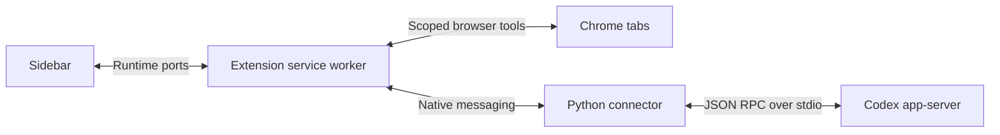
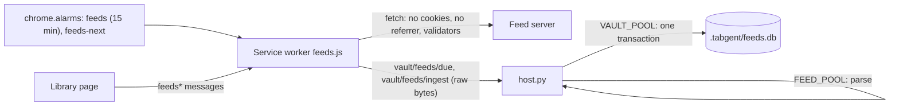

# Architecture



## Source map

| Path                              | Responsibility                                                              |
| --------------------------------- | --------------------------------------------------------------------------- |
| `extension/background.js`         | Tab/session ownership, native transport, selection routing.                 |
| `extension/bridge.js`             | Runtime port connecting a chat view to its owner tab.                       |
| `extension/browser-tools.js`      | Scope enforcement, browser actions, page reading and frame context.         |
| `extension/browser-input.js`      | CDP-based trusted input and coordinate actions.                             |
| `extension/selection-content.js`  | Selected text, DOM endpoints, offsets, and frame-relative geometry.         |
| `extension/highlight-content.js`  | Selection toolbar, saved webpage highlights, and highlight actions.         |
| `extension/highlight-note.js`     | Note preview and editor shared by the webpage and PDF.js reading layers.    |
| `extension/web-anchor.js`         | Normalized page text, web anchors, and verified anchor restoration.         |
| `extension/vault-client.js`       | Reading-vault requests over the native port, with ids and timeouts.         |
| `extension/pdf/viewer.js`         | PDF.js wrapper: loading, fallback, live quotes, and Agent PDF commands.     |
| `extension/pdf/pdf-highlights.js` | Selection toolbar, saved PDF highlights, and highlight actions in PDF.js.   |
| `extension/pdf/pdf-anchor.js`     | PDF page text, PDF anchors, and verified anchor restoration.                |
| `extension/pdf/file.html`         | The PDF.js viewer's entry page for PDFs opened from the computer.           |
| `extension/local-files.js`        | `file://` URL checks, the file access prompt, files open before access.     |
| `extension/local-pdf.js`          | Hands a local PDF in Chrome's own viewer to the PDF.js viewer.              |
| `extension/file-access.html`      | Explains Chrome's "Allow access to file URLs" setting, opened once.         |
| `extension/epub/`                 | Library and EPUB reader page: vault documents, imports, books, highlights.  |
| `extension/epub-routing.js`       | EPUB reader port registry and sender checks.                                |
| `extension/clipper.js`            | Clipping a page: injection, the replace prompt, bounds and the vault save.  |
| `extension/clip-images.js`        | A clip's images: download, type and size checks, uploads, Markdown links.   |
| `extension/youtube-player.js`     | A YouTube video's id and its player data, read in the page's own world.     |
| `extension/clip/`                 | Clipping scripts, transcripts, sanitizer settings, clipped-page reader.     |
| `extension/clip-routing.js`       | Clipped-page reader address, port registry and sender checks.               |
| `extension/feeds.js`              | Subscriptions: scheduled feed fetches and the library's feed messages.      |
| `extension/reading-companion.js`  | Highlight and page conversations: reading context and saved turns.          |
| `extension/reading.js`            | Reading context parts, turn records, and vault append parameters.           |
| `extension/session-config.js`     | Browser tool schema and agent instructions.                                 |
| `extension/ui/`                   | Chat rendering, composer, attachments, previews, approvals, and onboarding. |
| `extension/_locales/en/`          | English UI strings; i18n structure is retained.                             |
| `extension/native/host.py`        | App-server discovery, sessions, authentication events, and RPC transport.   |
| `extension/native/attachments.py` | Bounded uploads and text/PDF/DOCX reading.                                  |
| `extension/native/vault.py`       | Reading vault: notes by category, discussions, full texts and records.      |
| `extension/native/epub_text.py`   | EPUB chapter text for the vault, using the standard library only.           |
| `extension/native/feeds.py`       | Feed and OPML parsing, and the subscription index `.tabgent/feeds.db`.      |
| `extension/native/pdf_text.py`    | Imported PDF page text for the vault, read with macOS PDFKit.               |

Each webpage tab owns a session. Agent tabs share that session through runtime
ports and retain its original page context. The sidebar beside an Agent tab has
an independent session with the Agent tab as its context. The `agentViews` map
records ownership before the Agent page loads. Closing the source transfers
ownership to a remaining Agent tab; the native process closes with the final view.
The Agent tab keeps the closed page as its companion (`agentCompanions`): each
message names it with its last known address and `closed: true`, browser scope
follows the Agent tab's own window, and a browser action on the closed tab fails
with a tool error that says so. Sessions created in that view (Agent +, page
history, a highlight) belong to the Agent tab and start with what it knew of the page.
A prewarmed spare reduces startup work. Full Agent tabs hide the expand button.

Chrome owns the toolbar's sidebar toggle. The Agent + button creates an independent
Agent tab that inherits the source session's page and settings, without copying
conversation content. View-only sessions close when their final Agent tab closes.
There are no layout menus or persisted layout preferences. The only interface drawn
on websites is the reading layer described in [Webpage highlights](#webpage-highlights).

The service worker checks tool scope on every request. Selection messages derive
the owner tab and frame from Chrome's sender metadata, not a page-supplied tab ID.
Their URL comes from Chrome's frame record, because `sender.url` keeps the load-time
URL after `history.pushState`.
DOM locations are historical hints and must be checked against the live page.
Online PDF documents in top-level tabs are redirected to a bundled PDF.js viewer
using a response-header declarative rule. The source URL and Chrome tab ID remain
the conversation context. PDF.js runs locally with PDF JavaScript disabled. It
provides text-layer selections with page numbers/PDF coordinates, page reads,
exact text selection, highlights, and annotated PDF downloads. Highlights made with
Tabgent's selection toolbar are saved to the reading vault (see
[PDF highlights](#pdf-highlights)). The viewer's native annotation tools also support
manual highlights, comments and edits. Those PDF.js changes must be downloaded to
save a copy; they are not automatically persisted across reloads.

PDF viewer ports are validated by extension URL, tab, frame, and document ID;
Chrome hides extension documents from `webNavigation.getFrame`. Browser commands
are still checked against the selected tab/window scope. Vendor files and licenses
are in `extension/vendor/pdfjs`, with packaging details in its README.

A load failure or **Open in Chrome viewer** installs a tab/URL-specific session
allow rule before navigating back, preventing redirect loops. Other tabs continue
to use PDF.js. Embedded PDFs, POST responses and explicit attachment downloads are not
automatically redirected. PDFs opened from the computer have their own rule and entry page
(see [Files from the computer](#files-from-the-computer)). Existing open PDFs use the new
viewer after reload unless that tab/URL has opted into native fallback.

The native fallback is retained: **Quote in Agent** sends a right-click quote
without reliable page coordinates. For HTTP(S) PDF tabs, `browser read` fetches
the original bytes in Chrome and sends them to PDFKit in the native host. These
reads are limited to 10 MB and temporary files are deleted. Screenshot, pointer,
keyboard, and scroll tools operate the native viewer directly. Neither text
reading path implements OCR for scanned pages.

## Reading vault

The connector keeps reading highlights, comments and discussions in a local Markdown
folder, `~/Tabgent` by default (outside Desktop, Documents and Downloads, which macOS
may not let a connector started by Chrome write). The extension sends
`{ op: "vault", id, method, params }` on the existing native port and receives
`{ op: "vault", id, result }` or `{ op: "vault", id, error: { code, message } }`.
Vault requests run on their own single-worker queue in arrival order. They never use
`warm` settings, sessions, or the Codex app-server, so highlights save while Codex is
offline or signed out.

`vault/configure` stores a chosen folder in `$CODEX_HOME/projects/tabgent/vault.json`;
otherwise the default folder is created on the first write. Each write scaffolds
`AGENTS.md` (layout, `rg` retrieval hints, and reading rules for Codex) and `.tabgent/`
(the catalog and a `.gitignore` for files that change often). `vault/status` reports
`layout: 2`. The folder is laid out like a Readwise export:

```text
~/Tabgent/
├── AGENTS.md
├── Articles/ Tweets/ Videos/ Podcasts/ PDFs/ Books/ Local Files/   one note per document
├── Discussions/<category>/<name>.md            discussions with Codex
├── Full Document Contents/<category>/<name>.md  clipped text, or a book's or PDF's text
├── Attachments/Images/<hash>.<ext>             clipped images and covers, shared
├── Attachments/PDFs/<name>.pdf, Books/<name>.epub   visible copies of originals
└── .tabgent/
    ├── catalog.json                            document ID → files, URL → document ID
    └── documents/<document ID>/                anchors.json, article.json, article.html,
                                                source.json, original.pdf | original.epub
```

A document's category is chosen once, when it is created (`_category` in `vault.py`):
`tweets` for x.com and twitter.com, `videos` for YouTube watch, shorts and live pages
and clips the YouTube extractor read, `podcasts` for known podcast hosts and clips with
a transcript, `pdfs` and `books` by kind, `local-files` for `file://` pages, and
`articles` for every other page, including items saved from feeds (their feed is named
in the note). Category folders appear with their first note. Tabgent never moves a
document to another category.

File names come from the title (`_file_title`): Unicode NFC, without control, zero-width
and direction characters, with `/ \ : * ? " < > | # ^ [ ]` replaced by spaces, without
noise such as an unread count or a ` - YouTube` suffix, an X post's
`Author on X: "Text"` written `Author：Text`, a site and date for a generic title, and
at most 100 characters and 180 UTF-8 bytes (cut at a space between words, never inside
an emoji). A name is free when the note, full text and discussions folders (and the
visible original's) have no file of that name, compared without case; otherwise
`<name> (2)`, `(3)`... The name is chosen once and kept in the record.

A document ID (`article-…`, `paper-…`, `book-…`, from the title slug and a hash of the
URL) is an opaque key, independent of file names: it names the record folder and is the
`tabgent_id` in the front matter of each of the document's Markdown files
(`tabgent_part: discussions`, `full`, `full-2` for the others). The record and the
catalog name the files. A file the user renamed or moved inside the vault is found
again by a scan of the vault's Markdown files outside hidden folders, reading only
their first 2 KB, and only files with Tabgent's markers count; its new place is
recorded, and Tabgent never moves it back. A note the user deleted (or moved out of the
vault, or into Obsidian's `.trash`) is written again at its recorded place on the next
write. URLs are matched without their fragment, as in page history, through the
catalog, which is rebuilt from the records when missing. `vault/documents/list` lists
every record; each document reports `category`, `notesPath`, `discussionsPath`,
`fullTextPath` and its record `folder`.

`anchors.json` is the machine record: anchors, highlight IDs (`h001`, never reused),
the user's comments on highlights (`note`), discussion turns (idempotent on thread and
turn ID), and the document's category, name, files, the keys Tabgent wrote in the
note's front matter and a hash of each marked block it last wrote.

The note is the human record:

```text
---
tabgent_id: article-ada-lin-on-x-1a2b3c4d
title: "Ada Lin on X: \"Reading is a loop, not a line\""
aliases:
  - "Ada Lin on X: \"Reading is a loop, not a line\""
category: tweets
kind: web
source: "https://x.com/adalin/status/1"
author: "[[Ada Lin]]"
saved: 2026-10-19T21:03:00+08:00
---

# Ada Lin：Reading is a loop, not a line

<!-- tabgent:metadata document start -->
## 元数据

- 作者：[[Ada Lin]]
- 完整标题：Ada Lin on X: "Reading is a loop, not a line"
- 类别：#tweets
- 网址：https://x.com/adalin/status/1
- 保存：2026-10-19 · 剪藏：2026-10-19
- 全文：[[../Full Document Contents/Tweets/Ada Lin：Reading is a loop, not a line|查看全文 →]]
- 讨论：[[../Discussions/Tweets/Ada Lin：Reading is a loop, not a line|与 Codex 的讨论]]
<!-- tabgent:metadata document end -->

<!-- Tabgent 只在带 tabgent 标记的块里插入、更新或删除内容，其余内容都是你的。 -->

## 高亮

<!-- tabgent:highlight h001 start -->
- Reading is a loop: you return to the same passage. ^h001
    - 评论：和"精读要反复回到原文"是一回事。
    - 2026-10-19 21:05 · [原文位置](https://x.com/adalin/status/1#:~:text=Reading%20is%20a%20loop) · [[../Discussions/Tweets/Ada Lin：Reading is a loop, not a line#高亮 001|讨论 2 条]]
<!-- tabgent:highlight h001 end -->
```

Front matter keys are written when the note is created; later Tabgent adds only keys it
never wrote to the file (and `tabgent_id` whenever it is missing), and never changes or
removes a key, so the user's own keys such as `tags` stay. The metadata block holds the
cover, author, title, category tag, address, dates, the feed a saved item came from,
the clip's summary and transcript status, page or chapter counts, and links to the full
text, the visible original and the discussions. Each highlight is a list item: its
quoted text ending with its block ID (`^h001`), the user's comment as `- 评论：`, then
its location, time, a link to its place (the text fragment on the web page, the page of
the visible PDF copy, or the chapter in a book's full text) and to its discussion.
Links between the vault's notes are Obsidian links relative to the file
(`[[../Discussions/…#高亮 001|…]]`), so they resolve wherever the vault is, also inside a
larger Obsidian vault; images are relative Markdown links. The place between the
metadata block and `## 高亮` is kept for a document-level comment block, and `tags` in
the front matter for document tags.

`Discussions/<category>/<name>.md` has a `## 高亮 NNN` block per highlight with turns
(the quoted text, linking back to `^hNNN` in the note, then each turn's
`<!-- tabgent:turn <key> -->`, `**我** · <time>`, the question and `**Codex**`'s answer)
and a `## 关于整篇` block for document-level turns. Turns are only appended to the end
of their block; turns and blocks missing from the file (an editor saving its open copy
over Tabgent's) are written again on the next write.

Writes save the record first, then bring the Markdown files to what the record says,
then save the record again with the hashes of what was written. A block that is missing
is inserted; a block Tabgent has something new for is replaced when it is as Tabgent
last wrote it, and otherwise (the user edited it) the user's version is kept as their
own text above the new block. A block the user edited is left alone while Tabgent has
nothing new for it. A deleted highlight's block is removed, or kept as the user's text
when they edited it. HTML comment markers delimit Tabgent's blocks; blocks of kinds
Tabgent does not know are never touched. Unreadable JSON or non-UTF-8 Markdown is
reported, never replaced, and a request that would change a non-UTF-8 note writes
nothing.

`vault/highlight/update` (`{ documentId, highlightId, note }`) sets the user's own
comment on a highlight. It is trimmed, limited to 20,000 characters, and stored on the
highlight in `anchors.json` as `note`; every highlight result carries it (empty when
there is none). An empty note removes it, and an unchanged note writes nothing. A
deleted highlight takes its comment with it, and a deleted or unknown highlight returns
`not_found`. `anchors.json` is the source: editing the comment in the note does not
change the saved comment.

Writes hold a process lock plus an advisory lock on `.tabgent/lock`, and replace
files through a temporary file and rename, so concurrent requests and a second
connector process cannot interleave. Error codes are `invalid_params`, `not_found`,
`vault_unwritable`, `io_error`, `unknown_method`, and `internal_error`.

## Webpage highlights

Top-level HTTP(S) pages, and text files opened from the computer (see
[Files from the computer](#files-from-the-computer)), load `web-anchor.js` and
`highlight-content.js`. A non-empty
selection shows a small toolbar with **Highlight** and **Ask AI**. The toolbar and the
highlight popover live in one closed shadow root on a top-layer `popover` host. Inline
`!important` host styles and constructed stylesheets keep page CSS out and do not
need the page's `style-src`. Pressing Tab while the toolbar is visible moves focus
into it. Arrow keys move between actions, and Escape returns to the selection. Scrolling,
resizing, collapsing the selection, or pressing Escape dismisses it.

Highlights are painted with the CSS Custom Highlight API (`highlight.css`), so page
markup is never wrapped or rewritten. Custom highlights receive no events. A click
is hit-tested with `caretPositionFromPoint` and confirmed against the range's line
boxes, then opens **Ask AI** (or **Open discussion** when turns exist), **Add note**
(or **Edit note**) and **Delete**, with the user's note shown above them.
Clicks on links and controls are left to the page. Pages can read the highlight
registry, so a site can observe which of its passages are highlighted.

A web anchor follows the shared vault contract. It stores the quote with 32
characters of prefix and suffix, offsets into the page's normalized text, and a
DOM path hint. Normalized text joins light-DOM text nodes and collapses whitespace
and block boundaries into one space. Script and style text, soft hyphens, and
zero-width characters are dropped. Restoration tries the DOM hint, then the stored
position, and accepts either only when the quote and its full context match. Otherwise
every occurrence of the quote is scored by context. Identical passages are decided by
position only when one is clearly closer. A near-identical edited quote is accepted
only between its old context. Anything less certain stays unanchored: it keeps its
vault record, is never drawn on other text, and is reported to the tab's conversation
as `codex-highlight-status`. Late or replaced content triggers re-anchoring from a
mutation observer, throttled by the cost of the previous pass. SPA navigation reloads
the page's highlights.

The service worker accepts highlight messages only from the top frame of the
sender's current document. Vault URLs come from Chrome's frame record without the
fragment, because `sender.url` keeps the load-time URL after `history.pushState`.
`vault-client.js` sends `op: "vault"` requests over the existing connector port,
with request IDs, timeouts, and rejection on disconnect. Vault operations do not
claim or wait for a Codex session; opening the port still sends its usual prewarm
request. Delete and Ask AI on saved highlights are checked against the vault record
for the sender's URL.

**Ask AI** saves the highlight, then reuses the page-selection quote flow. The quote
carries `highlight: { documentId, highlightId }` and nearby text in
`context: { before, after }`. If saving fails, the quote is still sent without a
highlight. `chrome.sidePanel.open()` is called synchronously in the runtime message
listener. In Chrome 151, a content-script click allows the call only before the
listener's first await: a microtask, an extension API await, or a timer loses the
gesture. When the panel cannot open, the page asks the user to click the toolbar
button; the quote is already waiting in the conversation.

**Add note** opens a small editor from `highlight-note.js` in the same shadow root,
at the highlight. Focus moves to its text field and stays inside the editor (Tab
cycles through the field, Cancel and Save); Cmd/Ctrl+Enter saves, Escape cancels, and
neither acts during an input method's composition. Keys typed there stop at the
editor, so page shortcuts never see them. A click elsewhere closes an unchanged editor
and keeps one with unsaved text. Saving sends `highlightNote`; the service worker
checks the highlight against the vault record for the sender's URL, calls
`vault/highlight/update`, and tells the tab's side panels to refresh their list.

Highlights cover the top frame's light DOM. Iframes and shadow DOM are not drawn; PDFs
and EPUB books have their own reading layers, described next. Tabs opened before the extension was installed or reloaded
need a reload to show highlights.

## PDF highlights

The bundled PDF.js viewer has the same reading layer as webpages. `pdf-highlights.js`
runs in the viewer page and works inside the PDF.js frame. A text selection shows
**Highlight** and **Ask AI**; a click on a saved highlight shows the user's note,
**Ask AI** (or **Open discussion**), **Add note** (or **Edit note**) and **Delete**.
The note editor is the webpage one; it stops the keys typed into it, so PDF.js
shortcuts (such as `n` for the next page) do not fire. Strings, colors, keyboard behavior, and vault
messages are the webpage ones. `highlight.css` is linked, because the PDF.js page CSP
(`style-src 'self'`) blocks inline styles. The PDF.js floating highlight button is
turned off so there is one **Highlight** action; the PDF.js highlight tool still adds
annotations for `savePdf`.

Highlights are painted with the CSS Custom Highlight API on PDF.js text layers. They
are repainted when PDF.js renders a text layer again or splits it for find-bar
matches. The PDF bytes and the PDF.js annotation storage are never changed:
annotated downloads contain only PDF.js edits, and a saved highlight does not make
the native-viewer fallback warn about unsaved changes.

A page's text is its text-layer text, normalized like webpage text: whitespace runs
and line ends become one space. The text layer and
`getTextContent({ includeMarkedContent: true, disableNormalization: true })` give the
same text, so pages that are not rendered can still be searched. A PDF anchor is:

```text
{ kind: "pdf", page, endPage?, quote: { exact, prefix, suffix },
  textLayer: { start, end }, rects: [{ page, pdf: [x1, y1, x2, y2] }] }
```

`page` is one-based. `endPage` is present when a highlight crosses a page break; the
quote then joins the pages' text with one space, and `textLayer` offsets index that
joined text. `rects` are PDF user-space points merged per line. They are kept for
reference and are not used to restore. The location label is the localized page,
such as `p. 12` or `pp. 12–13`.

Restoration accepts the saved offsets on the saved page only when the quote and its
full context match. Next, the saved page is searched for the quote with the webpage
scoring (`matchQuote` in `web-anchor.js`). Only if that fails is the whole document
searched, which finds text that moved to another page, for example in a revised PDF at
the same URL. Identical passages are decided only when one is clearly closer to the
saved position. Anything less certain stays unanchored and unpainted, and is reported
as `codex-highlight-status`.

The vault document is the original PDF URL without its fragment, or `urn:sha256:<hex>`
for an imported PDF. Its title is the PDF metadata title, chosen as PDF.js does
(`pdf-info.js`), or the file name; `meta` carries the PDF author
and the host name. The service worker accepts PDF highlight messages only from the
current viewer document of the tab, the same check as PDF selections, and sends
`kind: "pdf"` with an anchor reshaped by `cleanPdfAnchor`. Like the webpage layer, the
viewer answers `tabgentHighlight` messages from the service worker in its top frame:
`context` returns a highlight's nearby text, `jump` scrolls its page into view and
marks it briefly, and `refresh` reloads the saved highlights (for example after a
saved turn) while keeping restored ones in place.

**Ask AI** follows the same gesture rule as webpages. The quote carries
`highlight: { documentId, highlightId, kind: "pdf" }`, the page label as `location`,
`context` with up to 1500 characters before and after (including the previous and
next page, whose text is loaded in advance so the click never waits), and
`locator: { kind: "pdf", anchor, page }`. It binds the conversation like a webpage
quote (see Reading conversations). A question without a highlight saves to the PDF's
document, because the worker maps the viewer tab to the original PDF URL with
`kind: "pdf"`. Codex reads PDFs one page at a time with
`browser read` (`page` and `offset`; the result includes the page count), so a long
PDF is never sent whole.

The native fallback viewer has no highlights. Scanned pages without a text layer
cannot be highlighted, and page labels use physical page numbers, not printed ones.

## EPUB reader

The bundled reader is an extension page, `epub/reader.html`, whose start screen is the
[library](#library-and-local-pdfs). It renders books with foliate-js
(`extension/vendor/foliate-js`) in paginated or scrolled mode, with a table of contents,
font size, and the reading position stored in `chrome.storage.local`. A book is opened
by choosing or dropping a file, or from the library.

A book's identity is the SHA-256 of its file: the vault URL is `urn:sha256:<hex>`, so a
re-picked file or the vault copy maps to the same `book-<title slug>-<hash>` document,
and another edition is another book. On first open the reader uploads the
file with `vault/source/save` in 2 MiB base64 chunks. The host appends them to
`.tabgent/uploads/<sha256>.part`, so an interrupted import resumes, verifies the hash,
and moves the file to `original.epub` in the document's record folder, with a
`source.json` record and an APFS clone for other apps in `Attachments/Books/<name>.epub`
(a plain copy on other file systems; when Tabgent's own copy is lost, it is restored
from that one if its hash matches). Originals are limited
to 100 MiB and never replaced. The tab URL then becomes `reader.html?book=<document ID>`,
which reopens the book through `vault/source/read` (checked against the recorded hash)
and names it in page history and message context. `vault/books/list` lists books whose
original is stored.

At import, `epub_text.py` reads each spine document with text, and the vault writes the
book's full text, `Full Document Contents/Books/<name>.md`: a table of contents, then a
`## <chapter>` section per chapter in reading order after `<!-- tabgent:section N -->`,
with the chapter's own headings two levels down. A text above 8 MiB is split into parts
at chapter boundaries (`<name>（第 2 部分）.md`). Titles come from the navigation
document or NCX, then the first heading. The archive is read in memory with entry and
total size limits, XML entity declarations are rejected, and a deleted full text is
written again from the original (a part the user edited is kept). `source.json` lists
the chapters (number, title, href, part); the reader names a selection's chapter by its
number, and `AGENTS.md` tells Codex to read the sections it needs instead of the whole
book.

Books cannot run scripts. Script resources are not loaded, `<script>` elements get an
inert type (so CFIs are unchanged), and event attributes, `srcdoc` and `javascript:` URLs
are removed before a chapter renders. The reader's own CSP, inherited by foliate's
`blob:` chapter frames, allows only the extension's scripts and blocks remote images,
fonts, styles and frames. The frames' sandbox allows no forms, popups or top navigation, and HTTP(S)
links open in a new tab.

An EPUB anchor is `{ kind: "epub", cfi, quote: { exact, prefix, suffix }, chapter:
{ href, title, index }, position }`. The quote, 32-character context and offsets use the
chapter's normalized text from `web-anchor.js`, and the highlight location is the
chapter title. A CFI is accepted only when it resolves to the quote with the same
context. Otherwise the quote is searched within that chapter with the webpage matcher.
Uncertain records are listed as not found in the reader's Highlights tab, never painted,
and reported as `codex-highlight-status`. Highlights are drawn by foliate's overlayer;
clicking one shows the user's note and offers **Ask AI** (or **Open discussion**),
**Add note** (or **Edit note**) and **Delete**. The note editor is part of the reader
page, with the same keys as on webpages, and saves through `epubHighlightNote`. The
Highlights tab shows each note under its quote. A `refresh` command on the reader port
reloads the highlight records (notes and turn counts) after a note is saved from the
side panel or a turn is saved.

The reader calls `chrome.sidePanel.open()` synchronously in the click, then asks the
service worker to save and hand off the selection through `handOffSelection()` and
`reading.focusHighlight()`, so each highlight has its own conversation as on webpages.
The quote's `url` is the book's `urn:sha256:` identity, and it carries
`highlight: { documentId, highlightId, kind: "epub" }`, the chapter title as `location`,
chapter text in `context: { before, after }`, and
`locator: { kind: "epub", anchor, documentId, chapterFile }`. `chapterFile` is the
absolute path of the chapter's Markdown file. Plain selections use the page selection
flow with an EPUB locator.

Each reader document registers an `epub` port, and the service worker accepts messages
only from a tab's current reader document. The port also names the open book, so
`pageDocument()` maps a reader tab to `{ url: "urn:sha256:…", kind: "epub" }` for
page-level saving, and it carries the side panel's highlight commands (jump, nearby
text) that webpages answer from their content script. The reading context of a
message about a book names its `chapters` folder.

The reader is not a browser tool target: the instructions tell Codex to read chapter
files through `reading_vault` instead.
Fixed-layout books use foliate's fixed-layout renderer, which has no overlay layer, so
their highlights are saved but not drawn (their notes are kept and listed). Book search
and EPUB files opened from websites or `file://` URLs are not supported.

## Library and local PDFs

The library is the start screen of `epub/reader.html`. It opens from the toolbar
button's context menu and from **Open library** in the side panel's Reading notes menu,
which opens it in a tab next to the page. It lists every vault document with
`vault/documents/list`, most recently updated first: title, kind (webpage, PDF, imported
PDF or EPUB), author or host, highlight count and the last update. Each entry is a link:

| Document     | Opens                                                        |
| ------------ | ------------------------------------------------------------ |
| Webpage      | Its HTTP(S) URL; the page restores its highlights.           |
| Clipped page | `clip/reader.html?url=<page URL>`; a second link opens it.   |
| Local file   | Its `file://` URL, opened with the tabs API.                 |
| PDF (web)    | `pdf/viewer.html?url=<PDF URL>`, the bundled PDF.js viewer.  |
| Imported PDF | `pdf/viewer.html?url=urn:sha256:<hex>`, from the vault copy. |
| EPUB         | `reader.html?book=<document ID>`, from the vault copy.       |

Entries whose original is not in the vault (an EPUB that was never imported, or a removed
file) are listed but not openable. Other URL schemes from the vault are never opened.

Choosing or dropping a file accepts EPUB books (handled as in [EPUB reader](#epub-reader))
and PDFs, recognized by their first bytes. A PDF is limited to 100 MiB, the vault's
limit for originals. The library reads its title and author with PDF.js, as the viewer
does, which also refuses a damaged file before it is copied; an encrypted PDF is named by
its file. Its identity is the SHA-256 of its bytes: `vault/source/save` stores it with
`kind: "pdf"` and the URL `urn:sha256:<hex>` in the same 2 MiB chunks, resumable uploads
and checks as an EPUB, as `original.pdf` in a `paper-<title slug>-<hash>` record with
`source.json` and a visible copy in `Attachments/PDFs/<name>.pdf`. The vault refuses a `urn:sha256:` URL that is not the file's hash. The same
file always maps to the same document, so dropping it again opens its existing copy.
After the import the tab opens the viewer for that identity.

At import, `pdf_text.py` reads every page's text with macOS PDFKit in one `osascript`
process (as the PDF fallback reader does for one page) and the vault writes its full
text, `Full Document Contents/PDFs/<name>.md`, with a `## 第 N 页` section per page with
text after `<!-- tabgent:page N -->`. Text is bounded per page and per document; pages
without text (scanned pages) get no section, and a PDF without any text, an encrypted
one, or one PDFKit cannot read is recorded in `source.json` (`pageError`) and still
opens. A deleted full text is written again when the file is imported again.
`reading_vault` searches it and reads a page by number, and the reading context of a
message about an imported PDF names its full text, so Codex can read the paper while its
viewer tab is closed. A highlight in the note links its page in the visible copy
(`[[…/Attachments/PDFs/<name>.pdf#page=N|原文位置]]`), which Obsidian opens at that page.

A PDF opened from the web and an imported copy of the same file stay separate documents
with separate notes. The web identity is the address, which can serve a revised file
later (see [PDF highlights](#pdf-highlights)), while the imported identity is the bytes;
Tabgent does not keep a hash of the online file, so it cannot tell that they are the
same, and merging would rewrite notes the user may have edited. The library lists both.

`pdfSource()` accepts `urn:sha256:<64 lowercase hex>` as a PDF source, so the viewer
tab is a PDF tab everywhere: highlights, Ask AI, plain selections, page history, the
per-message browser context, `pageDocument()` for page notes, and `browser read`. The
viewer of an imported PDF reads the vault copy with `pdfLocalRead` messages. The service
worker accepts them only from the tab's current top-frame viewer whose `pdf` port is
registered, resolves the document from the viewer's own address (never from the page's
request), and relays `vault/source/read`. The viewer checks the bytes against the hash
in its address and opens them with `PDFViewerApplication.open({ data })`. There is no
web address, so **Open in Chrome viewer** is hidden and `pdfFallback` is refused. An
imported PDF is not in the vault any more when the vault folder is changed; the viewer
then reports that it cannot be opened.

## Web clips

**Clip this page** (the toolbar button's and the page's context menus, the `clip-page`
command, Alt+Shift+S by default, and the side panel's Reading notes menu) saves a webpage's
main text into the page's own vault document. The page and its clip are one document named
by the URL, as for highlights, so highlights, notes and discussions belong to both.

`clipper.js` runs in the service worker. It takes the tab's top-frame URL and document from
`webNavigation.getFrame`, refuses anything but HTTP(S) pages outside incognito, and injects
`vendor/defuddle/defuddle.js`, `vendor/turndown/turndown.js`, the UMD build of DOMPurify,
`clip/sanitize-config.js`, `clip/clip-structure.js`, `clip/clip-media.js` and `clip/clip-content.js` into frame 0 with
`chrome.scripting.executeScript`. Nothing is loaded into pages that are not clipped. Each
later call checks that the injection result's `documentId` is still the frame's, so a page
that navigated mid-clip saves nothing. A single-page app can change its address without a
new document, so the worker also reads the frame again after each prompt and the clipping
script compares `location` with the address it was asked to clip; a page that moved stops
the clip and says so, and a prompt closes when the page's address changes. If the document
already has a clip, the page shows a prompt (a closed shadow root on a top-layer popover,
like the reading toolbar) and only **Replace** continues. **Clip selected text** from the
side panel checks that the page still selects the quote attached in the conversation. An
address whose vault document is a PDF (Chrome's own viewer) is refused.

`clip-content.js` runs Defuddle's synchronous `parse()` with `useAsync: false` and a
`fetch` that always rejects, so no extractor contacts a third party. Defuddle normalizes
some attributes of the document it is given, so it reads `document.cloneNode(true)`:
elements that `checkVisibility()` reports as not displayed are marked `hidden` in the copy
(except `display: contents`, which has no box but draws its children: tables built from divs
put their cell text in such wrappers), and images keep their displayed size, so the page the
user reads is never modified. Before Defuddle reads the copy, `clip-structure.js` turns
tables drawn with ARIA roles (`role="table"`, `grid` or `treegrid` with `row` and cell roles)
into real tables, header rows in `<thead>`, keeping the elements' other attributes so Defuddle
still drops noise grids (related posts; copied as attribute nodes, so a malformed name from
broken markup cannot stop the clip); puts loose text in a table cell that also holds
blocks into a block of its own (Defuddle replaces a layout table by its only block, which
dropped the text beside it); and turns inline elements holding only a space into that space
(Defuddle removes empty elements, and words ran together). On
`x.com` and `twitter.com`, single posts use Defuddle's X extractor with
`includeReplies: false` (the post and the author's thread loaded on the page); X articles
use its article extractor; timelines and profiles are refused. Visitors who are not logged
in get another layout without `data-testid` (the conversation is a list of plain `<article>`s
in `div#urt:conversation:<id>:…`, with a screen-reader `<h1>` that repeats the whole post),
where Defuddle's X extractor finds nothing and its generic extraction would keep the heading,
counts and everyone's replies. `clip-content.js` reads that layout itself: the article whose
status link is the address's post, then the author's consecutive replies (by the `@handle`
in each header), each post's `[dir="auto"]` text with links and emoji, and its
`pbs.twimg.com/media` images; quoted posts' parts, buttons and counts are left out. A post
address in neither layout is refused (`x-layout`, asking for a selection instead). Both
layouts get a short title, `<name> on X: "<first 80 characters>…"` (graphemes; a cut inside
a word of a space-separated script moves back to its space, at most 20 characters, so
Chinese and Japanese are cut by characters), and no "save whole page"
offer for a short post. The result is parsed into an
inert `DOMParser` document. Images keep only their address in `data-remote-src` (the best
`srcset` candidate up to 2048 pixels, `pbs.twimg.com` at `name=large`; tracking pixels and
`data:` images are dropped), frames and media become links, links become absolute HTTP(S)
or mail addresses or in-page fragments, and DOMPurify then removes everything else with the
allowlist in `sanitize-config.js` (no scripts, styles, `style` or `class` attributes, forms,
frames, SVG or media). Before that, layout tables (`role="presentation"`, holding tables or
headings, or at most one filled cell per row, and no header cells or caption) become blocks
in reading order, a table inside a table's cell becomes a line per row (cells joined with
" · "), and a line break at the edge of emphasis or a link moves outside it. Turndown converts
the cleaned HTML with Tabgent's rules for images, fenced code with its language,
strikethrough, MathML with LaTeX, and GFM tables (lines within a cell are joined with `<br>`;
tables with merged cells become lines of text); an inline element holding only a space keeps
it. The HTML is cut at a block boundary to 4 MiB and the
Markdown at a paragraph break (else a line break, never inside a surrogate pair) to 3 MiB
(UTF-8); a code fence the cut left open is closed, and each ends with a note. When little text
is found, the page offers **Save whole page** (Defuddle on `body` without low-score
removal) or, with a selection, the selected text only.

A figure of images keeps its caption beside them in the Markdown: the `<figcaption>` on the
line right after the image (or before it, where the HTML puts it first), in italics unless it
already has emphasis, with no blank line between; a figure of other content (a quote, a list)
keeps its caption as a paragraph. Defuddle itself moves a figure's caption after its image.
A paragraph after an image that is not a `<figcaption>` stays a paragraph (Meituan's posts
put their explanation there; it is not a caption).

The author, date and cover come from Defuddle (meta tags, JSON-LD, `<time>` and English
bylines, recorded as `metadata`), then from the line next to the page's first heading
(`作者：…`, or a date such as `2026-08-07` or `2026年3月5日` in an element whose class or id
names a date, time or publish; recorded as `title-line`), then from a few sites' own layouts
(`site:<host>`: Meituan's tech blog header; WeChat's publish time from the article's
`create_time`, its author line or account, and `msg_cdn_url`). Dates keep the site's time
zone: a date alone stays a date (a date Defuddle read as midnight UTC is written as the date),
and WeChat's Unix time is written in China time with its offset, as WeChat shows it. The
cover is `og:image`, `twitter:image`, JSON-LD `image.url` or `link[rel=image_src]`, else the
site's own cover; X posts and selections have none. `metaSources` in `article.json` names the
source of each value.

A YouTube video (`watch`, `shorts` or `live` on `www.youtube.com`) is clipped from its
player data, not its markup: YouTube keeps the current video's data in the page's own world
(the player's `getPlayerResponse()`; the markup's `ytInitialPlayerResponse` still names the
first video a tab opened). The worker reads it there with `chrome.scripting.executeScript`
in the `MAIN` world (`youtube-player.js`: title, channel, description, publish date,
thumbnail and caption tracks, bounded, only when its `videoId` is the address's) and passes
it to the clipping script, which checks it again (`clip-media.js`). The track saved is the
original language's own captions (the language of YouTube's automatic track), else that
automatic track (recorded as `auto`), else the default track. Its text is requested from the
page's own site with the page's cookies, as YouTube's player does: the track's address
(`fmt=json3`); else the player's own request for that track, found in the page's resource
timing (YouTube now answers caption requests only with a token the player adds, so this
works once captions are on); else the transcript panel when the user opened it. YouTube's
json3, srv1 and srv3 and WebVTT are read; cues become paragraphs (a new one at a chapter,
after a pause over three seconds, at a sentence end after 30 seconds, at the latest after 90
seconds, or 60 for automatic captions without punctuation), each starting with a link to its
moment (`watch?v=<id>&t=<s>s`), under chapter headings when the description has chapters
(lines starting with a timestamp, the first at 0:00, at least three, increasing). The
description is saved before it, with its links and timestamps linked. `transcript` in
`article.json` records the language, kind, name and source, or, when no text was available,
why: `login` (YouTube asks to sign in or to confirm the user is not a bot: nothing is
requested), `none`, `empty` (YouTube returned no text) or `unplayable`. Without a transcript
the clip is `contentStatus: "notesOnly"`, and the page and reader say why. Audio is never
transcribed.

A podcast episode page (known podcast hosts, a podcast player embedded in the page, JSON-LD
`PodcastEpisode` or an `og:type` naming an episode; a page that only offers an audio version
of an article is not one) gets its transcript added after the show notes when the page has
one: a block whose id or class names a transcript (also when the page keeps it collapsed),
the part under a "Transcript" heading or `<summary>`, or a page on the same site that a
"transcript" link leads to (requested with the page's cookies, cleaned by Defuddle without
running it). Without one, the clip is `notesOnly`.

A clip whose text is only links and at most 12 words besides, with no image (an embedded
video turned into a link, a page whose text did not load), is `contentStatus: "linksOnly"`
(not for selections or X posts). It is saved, but the page says that only links were saved
instead of the usual message, the reader shows a notice and the library marks it.

A coverage check guards against text the extraction drops silently (not for selections, X
posts, or video and podcast clips, whose text is notes and a transcript from captions or
another page: putting a page passage back could repeat the transcript). It walks the copy's
visible text nodes and looks for each in the extracted text (in page order, and again without
spaces). The content region is the deepest element holding 95% of the matched text, widened
to its `<article>` when that is at most half again as large. Inside it, navigation, forms,
buttons, dialogs, comments, sharing, likes, related or recommended posts, subscribe boxes,
ads, tables of contents, references and citations, summary boxes, headers, footers and
asides, counts standing alone (a count in a sentence or a table's cell is text), short labels
outside text blocks and link lists are not counted (class names, ids and labels are read as
words; CSS-module hashes are skipped), nor is back matter: a section headed "References",
"Further reading", "External links", "See also", "参考文献", "延伸阅读" and the like. Author, guest
and acknowledgement cards (by name, or text such as "A guest post by") count even inside a
footer, but not anywhere in a header, where they are the byline, nor when the card as a whole
is mostly links ("More from this author"; a linked author name is part of the card). When the
kept share falls under 95% with at least 150 characters missing, or one missing run reaches
300 characters, each missing run with kept text on both sides is put back after the kept text
that preceded it on the page; missing cards are put back wherever they are. Only whole
elements that lost all their text and hold no noise (counts and short labels aside) are put
back (40 characters or more, 30 for a card), copied with their links and emphasis but without
images or hidden parts (a row or row group stays in a table): an element that lost part of
its text was rewritten by the extractor (footnotes, citations), not dropped. If more is
missing than was kept (over 5,000 characters), the region is likely wrong: nothing but cards
is put back and the clip is marked `incomplete`; a check that fails leaves the clip as
extracted. The result's `coverage` (`visibleChars`, `keptChars`, `ratio`, `restoredPassages`,
`restoredChars`, `incomplete`) is bounded by `cleanClip`, recorded in `article.json`, and the
page's saved message says how many passages were put back or that text may be missing.

The worker treats the result as untrusted: `cleanClip` refuses oversized or empty text and
bounds every field before `vault/clip/save`. The vault writes `article.html` in the
document's record folder (the cleaned HTML in a page whose policy, `default-src 'none'`,
blocks scripts and remote loads if the file is opened directly), then the page's full
text, `Full Document Contents/<category>/<name>.md` (front matter with `source`,
`clipped` and the page metadata, a link back to the note, then the text), and last
`article.json`, the record naming both with their SHA-256 and size (the Markdown by its
logical name `article.md`). A clip is complete when the HTML has the recorded size and
the full text is there. A document with a clip conflicts unless the request says
`replace` and `expected` still names its `clippedAt`, so two tabs cannot overwrite each
other silently. A full text whose hash differs from the record (edited by the user) is
renamed to `<name>（编辑版 <time>）.md` (its `tabgent_part` becomes `edited`) before it is
replaced. All extraction happens in the browser; under the vault lock the connector only
writes and renames files. `vault/document/resolve` and `vault/documents/list` report the
clip (`fullTextPath`), the note's metadata links the full text, the side panel offers
**Clip this page again**, and the reading context of any message about the page names
its full text.

Images are saved by the worker (`clip-images.js`), not the page. The page's cover goes first
in the same download (so the count limit never leaves it out), with the same limits, Referer
and cookies; it is recorded as `cover: { source, file }` (`file` empty when it was not saved)
and in the front matter, and is not counted among the page's images. The clipping script writes
each image in the Markdown as a placeholder named by a random per-clip token, which the page
cannot read from the isolated world. The worker fetches each distinct address once with its
host access (no CORS), the Referer Chrome sends from the page (`referer.js`: Chrome's
default `strict-origin-when-cross-origin`, so the page address for the same origin and only
its origin otherwise; an extension's `fetch` cannot set this header, so each request gets a
`declarativeNetRequest` session rule for its exact address and the extension's own
background requests, removed when the request ends (if the rule cannot be added, the
request goes without a Referer; rules a stopped worker left are removed at its start); hosts such as sspai.com refuse image
requests without a Referer), and cookies only for the page's own
site and only on the first request (a same-site image is fetched with `redirect: 'manual'`,
and a redirect is followed again without cookies; the site test is an approximation without
the Public Suffix List), four at a time within 15 seconds each and 45 seconds overall. It keeps JPEG, PNG, GIF,
WebP and AVIF by their first bytes (never by `Content-Type`; SVG is not saved), up to 50
images, 5 MiB each and 30 MiB together, one file per SHA-256. Each image is uploaded with
`vault/clip/asset` in 2 MiB chunks, one request at a time, so other vault requests wait for
at most one chunk; the upload is staged in `.tabgent/uploads/asset-<sha256>.ready` after its
hash is checked. Placeholders then become `assets/<first 16 hex digits>.<ext>`, or the web
address for images that were not saved; `assets/` is a logical name, which the full text
file links as `../../Attachments/Images/<file>`. `vault/clip/save` refuses
(`missing_asset`) a clip whose images are neither staged nor already in
`Attachments/Images/` before it writes anything, copies staged images there (refusing a
linked folder; the staged copy stays for other clips that share the image and is pruned
after a day), records each image's logical file, hash, type and every address that
returned it (`sources`) in `article.json`, and removes images the previous clip recorded
that the new one does not use, unless another document's clip records them or a kept
edited copy links them; other files there are kept. Images the size limits cut away are not downloaded, and if
web addresses would make the Markdown too long, unsaved images keep only their description. Failed images are listed with
the reason. `article.html` keeps every image's address in `data-remote-src`; the reader maps
each of an image's addresses to its saved file through `article.json`.

Clipping covers the top frame's light DOM, not frames or shadow DOM.

### Clipped-page reader

`clip/reader.html?url=<page URL>` shows a page's clipped copy from the vault, offline. It
opens from the page's prompt after clipping (**Open clipped copy**), from the side panel's
Reading notes menu, and from the library, where a clipped page opens its copy and a second
link opens the live page. The page is not web-accessible, so websites cannot open or frame
it. Like the PDF.js viewer, its address names the document: `clipSource()` gives the page
URL, the reader registers a `clip` port, and `isCurrentClipSender` accepts only the tab's
current top-frame reader document. `clipRead`, `clipAsset` and `clipDelete` resolve the
document from that address, never from the request, and relay `vault/clip/read` (chunks of
`article.html` with the record), `vault/clip/asset/read` (only images the record lists, at
their exact path in `Attachments/Images/`, no symlinks) and `vault/clip/delete` (which
keeps an edited full text as a copy, with the images it may link, and leaves highlights,
comments and the user's files).

The clipped HTML is untrusted, also from the vault: the reader checks it against the
SHA-256 in `article.json` and refuses a changed copy, then cleans it again with the shared
DOMPurify allowlist plus `SANITIZE_NAMED_PROPS` (ids get a `user-content-` prefix, so page
markup cannot shadow Tabgent's globals; fragment links are rewritten to match). The page's
policy is `default-src 'none'` with `script-src 'self'`, `style-src 'self'`,
`img-src 'self' blob: data:`, `connect-src 'none'`, `frame-src 'self'` (only Tabgent's cleaning page), `form-action 'none'`
and `require-trusted-types-for 'script'` with only DOMPurify's policy, on top of the
extension policy that forbids inline scripts. Nothing is loaded from the web: images
recorded in `article.json` are read from the vault in chunks when they come into view and
shown as `blob:` URLs; others show their description and a link to them online. Links open
in a new tab with `noopener noreferrer`; other schemes lose their `href`. The byline shows the
published date as the page states it (formatted in UTC from its date part, so `2026-08-07` is
never shown as the day before), and the cover shows above the text unless the text already
has that image. The library shows each clip's cover from the vault when its entry comes into
view (`libraryCover`, relayed to `vault/clip/asset/read`, which reads only images the record
lists), for covers up to 1 MiB: the list reads them through the vault queue that highlights
and notes share.

The reader loads the webpage reading layer (`selection-content.js`, `web-anchor.js`,
`highlight-note.js` and `highlight-content.js`) after setting `globalThis.tabgentReadingView`
to the page URL, the article element, its title and metadata, and the view name `clip`.
`highlight-content.js` then indexes only the article, names the page in its messages, and
resolves anchors for that view. The service worker accepts highlight and selection messages
from the current reader as from the page, with `pageUrl` the page URL, and marks anchors made
in the reader `view: 'clip'` (a page cannot set it). Offsets and DOM paths of an anchor are
used only in the view it was made in; in the other view the quote and its context decide, so
a passage repeated in identical context there is left unanchored rather than guessed. Ask
AI binds the page's highlight, with `locator.view: 'clip'`. `pageDocument()`, page history,
the per-message browser context (`viewer: 'clip'`) and `readingState` (`page.view`) map the
reader tab to the page. The reader is not a browser tool target; the instructions tell Codex
to read its full text file instead. Reading positions and the text size stay in
`chrome.storage.local`.

## Subscriptions

The library's **Subscriptions** tab (`epub/feeds-ui.js`, `reader.html?view=feeds`)
subscribes to RSS 2.0/0.9x, RSS 1.0 (RDF), Atom and JSON Feed. Network work stays in
Chrome and parsing in the connector:



- **Adding.** The page sends `feedsProbe`; the worker fetches the address without cookies
  (a feed up to 5 MiB, a page read up to 2 MiB, 20 s). A feed, by its first bytes or its
  type, is previewed by `vault/feeds/preview`; a page comes back to the library, which
  reads it with `DOMParser` (an inert document) for `<link rel="alternate">` feeds and
  otherwise tries `/feed`, `/rss`, `/rss.xml`, `/atom.xml`, `/feed.xml` and `/index.xml`
  on the same origin. `feedsSubscribe` fetches the feed again and passes its raw bytes to
  `vault/feeds/subscribe`, so the first items arrive at once. OPML files go through
  `vault/feeds/opml/parse` (the same parser) and `feedsImport` adds them without fetching;
  they are first checked ten a minute. `vault/feeds/opml/export` writes OPML 2.0 with the
  categories, saved by the page with a Blob link. An address is subscribed once; at most
  500 subscriptions.
- **Schedule.** A periodic `feeds` alarm (15 minutes) and a one-shot `feeds-next` alarm
  for the next subscription due sooner run `vault/feeds/due` (at most 20), fetch three at
  a time with `If-None-Match`/`If-Modified-Since`, `cache: 'no-store'`,
  `credentials: 'omit'` and `referrerPolicy: 'no-referrer'`, and hand each response to
  `vault/feeds/ingest` as base64 of the raw bytes: the connector picks the encoding (BOM,
  HTTP charset, XML declaration; GBK and GB2312 through gb18030). A run starts no new
  request after 60 s. The alarms exist only while there are subscriptions
  (`feedsActive` in extension storage), so the connector is not woken otherwise; after a
  browser start, an install or an update, `feeds-next` checks overdue subscriptions a
  minute later. **Pause all subscriptions** (`feedsPaused`) skips scheduled runs.
- **Intervals and failures.** The default is 60 minutes; the feed's `<ttl>` or
  `sy:updatePeriod`, the response's `Cache-Control: max-age`, or the user's setting
  change it within 30 minutes to 24 hours, doubled (up to 12 hours) after 14 days without
  new items, with ±10% jitter. A failure (network, HTTP error, a feed that does not parse)
  backs off from 30 minutes, doubling up to a day; `429`/`503` honour `Retry-After`; `410`,
  and `404` for seven days, mark the subscription gone; `401`/`403` three times mark it
  refused. Stopped subscriptions are not checked until the user retries or refreshes one.
  A feed that answers from the same other address three fetches in a row has moved there.
- **Parsing** (`feeds.py`, standard library). The system Python on macOS links expat
  2.2.8, which predates expat's entity amplification limits, so the parser builds its own
  tree with expat and refuses a DTD internal subset and every entity declaration; it sets
  no external entity handler and never loads a DTD. RSS 0.91's external DOCTYPE is read
  without loading it, its HTML entities through `SkippedEntityHandler`; a feed that uses
  `&nbsp;` without any DTD is read again with numeric references. Input is at most 5 MiB,
  100,000 elements and depth 100; at most the newest 200 entries are read, item HTML is
  bounded to 512 Ki characters and summaries to 1,000. Item HTML is stored as the feed
  sent it and is untrusted; the reader cleans it before showing it.
- **Threads.** `host.py` parses `preview`, `subscribe` and `ingest` on a single
  `FEED_POOL` thread, outside the vault lock and queue, then writes on `VAULT_POOL` in one
  `BEGIN IMMEDIATE` transaction under the vault lock. `preview` and `opml/parse` need no
  vault.
- **Index.** `.tabgent/feeds.db` (SQLite, `journal_mode=DELETE`, created by the first
  subscription; reads never create it; a link at its place is refused) has `sources`
  (address, title, category, settings, validators, schedule, failures, status), `items`
  (identity, title, author, dates, summary, state), `item_content` (the feed's HTML, or the cleaned full text) and
  `seen`. Item keys are the guid, Atom `id` or JSON Feed `id`, else the link, else a hash
  of the title, date and summary; an entry with a known key, or a new guid for a known
  link, is the same item, and a changed entry is updated in place. The identity link drops
  the fragment and `utm_*`, `fbclid`, `gclid`, `mc_cid` and `mc_eid`. A new subscription's
  20 newest entries are unread; older ones are only recorded in `seen`, so they never come
  back as new. Each subscription keeps at most 200 unread items (older ones are archived),
  500 records and 2,000 seen keys. Unsubscribing deletes its items. Nothing in the index is
  a vault document, and `reading_vault` does not read it.
- **Senders.** Every `feeds*` message must come from the library page whose `epub` port is
  registered (`isCurrentEpubSender`); content scripts and other pages are refused.

### Reading and saving items

**The inbox.** `vault/feeds/library` lists one entry per address, newest first, for the views
unread (`state = 'inbox'`, not read), later, archive and all, optionally for one
subscription; an address in several feeds names all of them. Later and archive also list
saved documents marked so (`document.library` in `anchors.json`, set with
`vault/document/state`); a saved document wins over the items at its address.
`vault/feeds/mark` sets read, unread and the state by address, so every feed's entry
changes together, and **Mark all as read** marks the unread items of the inbox or of one
subscription, with their other feeds' entries.

**The reader.** An item opens in the clip reader at its address (`clip/reader.html?url=`, the
identity link, or `urn:tabgent:feed:<sha256 of subscription address and key>` for an entry
without a link, which `clipSource()` accepts). `feedOpen` (from the reader's own address,
checked by `isCurrentClipSender`) relays `vault/feeds/open`, which marks the address read
and returns the item, its subscription's settings and its content. A saved item shows its
vault copy as a clip does; otherwise the reader shows the feed's HTML, or full text:

- `feedFullText` fetches the item's identity address (without tracking parameters; never an
  address from the request) with `no-referrer`, at most 5 MiB in 20 s. When the item is on
  the subscription's own site (`sameSite()` from `clip-images.js` against the feed address
  or its site address), it sends cookies with `redirect: 'manual'`. On an `opaqueredirect`,
  it fetches again with `credentials: 'omit'` and `redirect: 'follow'` to learn the final
  address, and with cookies once more only if that address is still the item's own site.
  Other items (an aggregator's links) are fetched without cookies. The page is decoded by its HTTP or
  `<meta>` charset. The reader extracts the article with Defuddle and caches the cleaned
  HTML with `vault/feeds/content`. Automatic when the subscription's full text setting is
  **Always**, or **When the feed has only a summary** (an item without `content:encoded` or
  Atom content, or with under 1,000 characters of it); otherwise on request.
- Cleaning runs in `clip/extract.html`, a same-origin frame (the reader's policy now allows
  `frame-src 'self'`) that loads Defuddle, Turndown, DOMPurify, `clip-structure.js` and
  `clip-content.js` and
  nothing else. The reader keeps Trusted Types, which Defuddle and HTML parsing cannot meet,
  and calls the frame's `tabgentClip.clean()` directly. `clean()` shares the clipping
  script's pipeline (`finish()`): links, frames and media, images as `data-remote-src`,
  DOMPurify, the Markdown and the limits. The reader cleans the result again before showing
  it.
- Images come from `feedImage`: the worker fetches the address without cookies, with the
  Referer of the item's identity address (`referer.js`, as for clips), skips known trackers (feed counters, analytics and `pixel`/`beacon` images),
  keeps JPEG, PNG, GIF, WebP and AVIF by their bytes up to 5 MiB, and refuses all when the
  subscription's images are off. The reader shows them as `blob:` URLs.

**Saving.** **Save to library**, or a highlight, note or question about an item not saved
yet, saves what the reader shows. For a highlight the worker asks the reader over its `clip`
port (`feedCommit`) before `vault/highlight/create`, after opening the side panel for Ask
AI; for a question the reading companion does the same before it builds the reading context,
so Codex gets the full text path. `feedSave` bounds the result with `cleanClip`, fetches
the images without cookies, and calls `vault/clip/save` with
`origin: { type: 'feed', method: 'feed' | 'fulltext', sourceId, sourceUrl, sourceTitle, guid,
publishedAt, pageUrl }`, which accepts `urn:tabgent:feed:` addresses for feed items only.
`vault/feeds/saved` then links every item at the address to the document and moves its
later or archive state into `document.library`, in the vault lock. A page clipped before is
not replaced: the item joins that document. Prev/next navigation between items is not
implemented.

## Files from the computer

Tabgent works on files the user opens in Chrome from the computer, typically by
double-clicking a PDF, Markdown, text or HTML file whose default application is Chrome.
Nothing is imported first. A `file://` URL is a document only when it names a file: a
directory listing (its URL ends in `/`) and a URL with a host are never documents, readable
tabs, or senders.

**File access.** The manifest requests `file:///*`, and Chrome grants it only after the user
turns on **Allow access to file URLs** on Tabgent's page in `chrome://extensions`; the
extension cannot turn it on. `chrome.extension.isAllowedFileSchemeAccess()` reports it.
Without it, Chrome injects no content scripts into `file://` pages, applies no
declarative rules to them and refuses scripting, but webNavigation events still report the
URLs. The first committed top-level navigation to a readable type (`.pdf`, `.md`,
`.markdown`, `.txt`, `.html` and similar) while access is off opens `file-access.html`
once, next to the file (`fileAccessPrompted` in `chrome.storage.local`). It explains the
setting and opens `chrome://extensions/?id=<extension ID>`. The side panel's context
reports `fileAccess: false` for a local companion tab, which shows a reminder with the
same button. Changing the setting reloads the extension. The worker stores the last known
state (`fileAccess`); when it changes from off to on, local tabs get `local-pdf.js`, the
selection script, the reading layer and its stylesheet, so open files work without a reload.

**Markdown, text and HTML files.** The manifest declares the selection script (top frame
only) and the reading layer for `file:///*`, excluding URLs that end in `/`. The reading
layer runs only when Chrome shows a text document (`text/*`, XHTML, XML or JSON), so a PDF,
image or media file gets none. Highlights, Ask AI, notes and page conversations work as on
webpages: the worker accepts `file://` senders from the top frame of the current document,
checked against Chrome's frame record like HTTP(S) senders, and accepts no `file://`
subframe, because a local page can load other local files into frames. The vault document
is the `file://` URL without its fragment, kind `web`, filed under `Local Files/`. A text file is
edited in place, so a content hash would orphan its notes after every edit; the path keeps
them, and the web anchors re-find passages after edits. Moving or renaming the file leaves
its notes at the old path. Markdown is shown as Chrome shows it, as plain text.

**PDFs.** A second dynamic redirect rule (`900002`) matches main-frame `file://` URLs whose
path ends in `.pdf` (case-insensitive) and sends them to `pdf/file.html?url=<file URL>`.
Chrome applies it before its own viewer loads and records a server redirect, so the tab
shows no flash of Chrome's viewer and history has no `file://` entry. Chrome applies
extension rules only after the extension has loaded: a PDF that opens Chrome at launch
loads in Chrome's viewer first. `local-pdf.js`, declared for `file:///*` at
`document_start`, runs in Chrome's PDF document (`document.contentType` is
`application/pdf`) and asks the worker with `localPdfOpen`, which also covers PDFs whose
name does not end in `.pdf`. The worker answers with the viewer URL unless a session rule
records that the user chose Chrome's viewer for that tab and URL, and the script replaces
the location, without a history entry. `chrome.runtime.onStartup` injects the script into
local tabs that loaded before the extension.

`file.html` is `viewer.html` under another name. It is web accessible only to `file://`
pages, so a link in a local HTML file can open a local PDF in it, while a website cannot
navigate to it; `viewer.html` (web accessible to HTTP(S) pages) never accepts a `file://`
source. The viewer refuses a `file://` source in a frame. It reads the file with `fetch()`,
which Chrome allows extension pages while file access is on, through the same browser
process that loaded the `file://` URL. It then computes the SHA-256 of the bytes, opens a
copy of them in PDF.js, and sends `{ type: "document", sha256 }` on its `pdf` port, again
after every reconnect. The worker keeps the hash only for a `file.html` port in a tab's top
frame. **Open in Chrome viewer** adds the same tab-scoped session allow rule as for online
PDFs and navigates back to the `file://` URL.

The vault document of a local PDF is `urn:sha256:<hex>`, kind `pdf`, as for a PDF imported
in the library: the same file opened from anywhere, renamed, moved or imported shares one
document, and a changed file is a new one. Highlight and page-conversation messages from
the viewer resolve that URN from the hash its port announced (waiting briefly for it),
never from the page or its path. The quote of an Ask AI hand-off carries the URN, while the
per-message browser context names the `file://` URL, so Codex sees where the file is. As for
webpages, an Agent tab whose local page closes keeps the page's last `file://` address
and its document. A local PDF's remembered document also records the file's address
(`fileUrl`), so a reload of its viewer, which commits `file.html` again and names the file
only once it is read, keeps the document while the tab shows the same file.

The viewer copies the PDF into the vault once the document exists (its first highlight, or
when a saved page conversation or a reopened PDF finds the document), through
`pdfFileSave` messages relaying `vault/source/save` in the import's 2 MiB chunks. The worker
accepts them only from the tab's current `file.html` viewer and fills in `url` and
`sha256` from the announced hash; the vault checks the bytes. The copy is `original.pdf`
with `source.json` and the page text in its full text, exactly as an import, so the library
reopens it and Codex can read its pages after the file moves or the tab closes. Copying at
the first note, rather than on open, means opening PDFs to read them writes nothing, while
any PDF with notes keeps its source. A PDF larger than the 100 MiB vault limit keeps its
notes without a copy.

**Agent.** Local tabs are in the browser tool's scope like HTTP(S) tabs, listed by their
`file://` URL (a local PDF by its file, not the viewer). They are read-only: `read`,
`frames`, `screenshot`, `scroll`, `focus`, history navigation and the PDF.js commands work;
`click`, `hover`, `drag`, `type`, `press`, `select`, `check`, `resources` and
`saveResource` are refused, so Agent cannot follow a link in a local page to open another
file. `read` covers the top frame of a local page and never its `file://` frames.
`navigate`, `open` and conversation links accept only HTTP(S) URLs, so Agent never opens a
local file. Reading a local PDF left in Chrome's viewer fetches the file in the worker and
uses the PDFKit path of online PDFs.

## Reading conversations

`reading-companion.js` runs in the service worker and binds conversations to vault
documents and highlights. It lives there rather than in the side panel because the
worker receives every app-server notification for every session, whether or not a
view is open. The native host would add no durability: it and its Codex processes
exit when the worker's port closes, which also ends any running turn.

A quote that carries `highlight: { documentId, highlightId }` binds its conversation
to that highlight. Any reader can send it (web, PDF or EPUB, named by the highlight or
locator `kind`). Follow-ups keep the binding while the companion page shows the same
document. The worker remembers the document each companion tab last showed
(`pageDocuments`, forgotten when the tab navigates elsewhere; the EPUB reader keeps
its book while the tab stays in the reader, as on a reload), so after the page closes
its Agent tab still binds to it and saves there. **Ask AI** on a highlight with saved
turns reopens its latest thread through the page-history resume path, with the quote
attached again. A new highlight reuses an empty conversation and otherwise starts its
own, so each highlight's thread holds its discussion. The highlight list in the Page
conversations drawer does the same, and jumps to anchored highlights; unanchored ones
are marked and keep their notes. Each entry shows the user's note and edits it inline
(`readingNote`); the worker checks the highlight against the companion tab's document,
saves it, and asks the page or reader to refresh its highlight records. A draft
survives list refreshes.

The worker adds a hidden reading-context part after the browser context of each
message. It names the document (title, URL, kind and notes file), the bound
highlight (its text unless the quote is attached, and the user's note on it as
`userNote`, read fresh for each message and cut to 2,000 characters), up to five
earlier turns on it
from other threads (about 6,000 characters, sent once per thread), the vault folder
with its `AGENTS.md`, and the save target. The part is also the turn's durable
record: on `turn/completed` with status `completed`, the worker reads it back from
the turn's user message and calls `vault/discussion/append` with the user's own
words (quotes other than the highlight become a Markdown block quote) and the final
non-commentary answer. Appends are idempotent on thread and turn ID. Failures that
retrying can fix wait in `chrome.storage.local` (`readingOutbox`, at most 100) and
retry after the next successful save and on worker start.

Page-level questions save to the `## 关于整篇` block of the document's discussions only when the
conversation is set to save. **Reading notes** in the composer shows the target
(Highlight N, Page notes or Not saved). It defaults on for a highlight conversation
or when the page already has vault notes, and off otherwise, so unrelated
browser-automation chats are not written to the vault. Its menu also shows the vault
folder and changes it with `vault/configure`; existing notes are not moved.

For questions across documents, Codex searches the vault on demand. The read-only
sandbox already allows reading the vault folder, but in Ask for approval mode Codex
asks before every shell command, including `rg` and `cat`. The connector therefore
adds a `reading_vault` dynamic tool next to `read_attachment`. The host answers it
locally on the vault queue: `list` names the documents with their notes, discussions
and full text (and, with `document`, a book's or PDF's table of contents), `search` ranks
lines of notes, then discussions, then clipped pages' full text by matching keywords
(front matter is skipped; full-text matches name their section), optionally within one
`document`. A book's or imported PDF's full text is searched only when `document` names
it, and its notes still rank first, so their text never crowds out the user's notes and a
search never scans the whole library. `read` returns numbered lines of the vault's
`AGENTS.md` or of a document's file, by the path `list` or `search` gave or by
`document` and `part` (`notes`, `discussions`, `full`, `anchors`); with `section` (a
chapter or page number) it reads that section of the full text, in whichever part it
is, and `offset` counts from the section's start. Files are read as streams, so
full texts of several MiB are fine. The vault folder may be shared, for example with
Obsidian or the home folder, so no other file is readable: only the files the catalog
names for a document, at their exact place (no symlink in between, the name as
written), whose front matter names that document. The tool cannot write. Shell reads still work where the permission mode
allows them. The instructions in
`session-config.js` and the vault's `AGENTS.md` describe both.

## Working on the UI

Keep the bottom toolbar on one line. Long page titles truncate and open a details
popover on click. Selection drafts show two lines until expanded. Image attachments
use thumbnail-only chips and an original-image preview; ordinary file attachments
retain their filenames. All new user-facing strings belong in the English catalog.

## Boundaries

A Chrome extension cannot reproduce all browser chrome or desktop-app behaviors.
Side-panel opening requires a user gesture, and the call must happen before any
await; native menus and protected pages have separate restrictions. Keep these
limitations explicit rather than emulating a second browser or silently claiming
unsupported capabilities.

## Native Codex tools

The connector launches `codex app-server --stdio` using the user's existing
`CODEX_HOME`. It adds `browser` and `read_attachment` without disabling Codex's
native tools or overriding feature flags. Web search mode and configured
Apps/MCP integrations follow the user's Codex configuration; this does not
install or authorize integrations or force experimental features on.

Built-in web search handles external research; the browser tool handles the
companion page and scoped Chrome interaction. Command and file tools retain
the connector's read-only sandbox and `untrusted` approval policy. Tool
availability also depends on the installed Codex version and selected model.
See the [Codex configuration reference](https://learn.chatgpt.com/docs/config-file/config-reference).

## Linked conversations

New tabs opened from webpage links, Agent conversation links, or the browser tool
retain their source conversation. When both threads are available, the connector
records reciprocal parent/child notes with thread IDs and source page metadata.
The notes are appended with `thread/inject_items`, without copying history or
starting a model turn. The browser new-tab button and Agent + create independent
root conversations; Agent + copies page context and settings only. Opening another
view of the same Agent is not a branch.

Relationships are journaled under
`$CODEX_HOME/projects/tabgent/lineage/`. The native host checks
rollout markers to deduplicate retries, and flushes pending notes on resume and
before new input. Closed parents can be resumed briefly to record their note;
locked/unavailable threads retain pending notes until the connector can access them.
Agents can use the IDs to look up local Codex session history. Page titles and URLs
in the notes are explicitly untrusted data.

The chat renders each relationship as a chronological notice in the message stream,
using `bridge/thread/relations` to read the same durable records injected into the
model's context. Child chats identify their parent; parent chats announce each child.
Titles link to existing conversation tabs and focus their windows. Closed tabs reopen
the same thread; IDs remain available in a details menu. Adjacent child notices created
within a minute collapse into a group. Reconnects and duplicate notifications do not
duplicate notices.

## Page conversation history

The collapsible Page conversations drawer indexes thread IDs, titles, settings, and
associated URLs in `chrome.storage.local`. Conversation content stays in Codex's
session storage. Exact URLs (including queries and fragments) remain distinct; the
PDF viewer uses its original document URL. One conversation can be associated with
multiple URLs as its companion tab navigates.

Selecting history remaps the current Agent view to the existing session, or resumes
the stored thread ID when it is no longer active. It does not create lineage. Drafts
and attachments stay with their sessions. The index survives browser restarts, but
clearing extension data removes it. Existing open sessions are indexed on first use;
closed conversations predating this feature cannot be reconstructed reliably.

Only threads with an accepted user message enter page history. Merely opening or
cloning a chat and injected lineage notes do not qualify. Older index entries are
checked against Codex history on first access; empty entries are removed from the
index, while unavailable records remain hidden for a later retry.

## Per-message browser context

Each Agent view retains its own companion tab, independently of its shared thread.
The connector prepends a text context item (tab ID, window ID, URL, title) to each
submitted message. Queued messages retain this snapshot when started or steered
from another view. When the companion tab has closed, the item keeps the page's last
known URL and title and adds `closed: true`. The UI hides this routing item and
continues showing the bound page in the composer, marked closed once it is. Page
titles and URLs are treated as untrusted data.

Every browser action requires an explicit `tabId`, including `context`, `tabs`, and
`open` (where it identifies the source window's tab). Missing IDs fail validation;
there is no implicit target. The message's originating tab anchors window scope.

Agent-authored Markdown links can carry the exact title `browser:current` or
`browser:new`. The Agent chooses using task context; the renderer converts the
marker into a localized hover hint and click intent. Missing or unknown markers
open a new tab. Modified clicks always request a new tab. Current-tab navigation
uses the clicking view's companion page, preserves the Agent view, and does not
create lineage. Browser tool navigation remains an explicit navigate/open choice.

Page history associates a thread with every URL on which the user submits a message. The URL is captured in that message’s browser context before the request, so later navigation cannot move the association. Navigation alone does not add an entry. The drawer shows conversations associated with the current tab URL plus the current conversation if it has user messages, deduplicated by thread ID. Including the current conversation does not persist a URL association. If the tab closes, the view keeps its last known page address.
