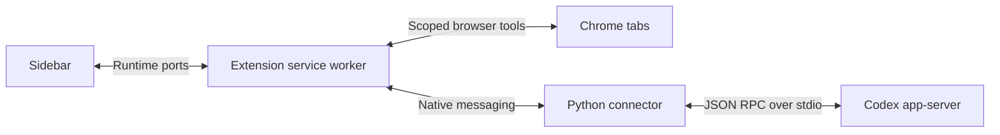

# Architecture



## Source map

| Path                              | Responsibility                                                              |
| --------------------------------- | --------------------------------------------------------------------------- |
| `extension/background.js`         | Tab/session ownership, native transport, selection routing.                 |
| `extension/bridge.js`             | Runtime port connecting a chat view to its owner tab.                       |
| `extension/browser-tools.js`      | Scope enforcement, browser actions, page reading and frame context.         |
| `extension/browser-input.js`      | CDP-based trusted input and coordinate actions.                             |
| `extension/selection-content.js`  | Selected text, DOM endpoints, offsets, and frame-relative geometry.         |
| `extension/highlight-content.js`  | Selection toolbar, saved webpage highlights, and highlight actions.         |
| `extension/web-anchor.js`         | Normalized page text, web anchors, and verified anchor restoration.         |
| `extension/vault-client.js`       | Reading-vault requests over the native port, with ids and timeouts.         |
| `extension/pdf/viewer.js`         | PDF.js wrapper: loading, fallback, live quotes, and Agent PDF commands.     |
| `extension/pdf/pdf-highlights.js` | Selection toolbar, saved PDF highlights, and highlight actions in PDF.js.   |
| `extension/pdf/pdf-anchor.js`     | PDF page text, PDF anchors, and verified anchor restoration.                |
| `extension/epub/`                 | Library and EPUB reader page: vault documents, imports, books, highlights.  |
| `extension/epub-routing.js`       | EPUB reader port registry and sender checks.                                |
| `extension/reading-companion.js`  | Highlight and page conversations: reading context and saved turns.          |
| `extension/reading.js`            | Reading context parts, turn records, and vault append parameters.           |
| `extension/session-config.js`     | Browser tool schema and agent instructions.                                 |
| `extension/ui/`                   | Chat rendering, composer, attachments, previews, approvals, and onboarding. |
| `extension/_locales/en/`          | English UI strings; i18n structure is retained.                             |
| `extension/native/host.py`        | App-server discovery, sessions, authentication events, and RPC transport.   |
| `extension/native/attachments.py` | Bounded uploads and text/PDF/DOCX reading.                                  |
| `extension/native/vault.py`       | ReadingVault highlights, discussions, and Markdown files.                   |
| `extension/native/epub_text.py`   | EPUB chapter text for the vault, using the standard library only.           |

Each webpage tab owns a session. Agent tabs share that session through runtime
ports and retain its original page context. The sidebar beside an Agent tab has
an independent session with the Agent tab as its context. The `agentViews` map
records ownership before the Agent page loads. Closing the source transfers
ownership to a remaining Agent tab; the native process closes with the final view.
A prewarmed spare reduces startup work. Full Agent tabs hide the expand button.

Chrome owns the toolbar's sidebar toggle. The Agent + button creates an independent
Agent tab that inherits the source session's page and settings, without copying
conversation content. View-only sessions close when their final Agent tab closes.
There are no layout menus or persisted layout preferences. The only interface drawn
on websites is the reading layer described in [Webpage highlights](#webpage-highlights).

The service worker checks tool scope on every request. Selection messages derive
the owner tab and frame from Chrome's sender metadata, not a page-supplied tab ID.
Their URL comes from Chrome's frame record, because `sender.url` keeps the load-time
URL after `history.pushState`.
DOM locations are historical hints and must be checked against the live page.
Online PDF documents in top-level tabs are redirected to a bundled PDF.js viewer
using a response-header declarative rule. The source URL and Chrome tab ID remain
the conversation context. PDF.js runs locally with PDF JavaScript disabled. It
provides text-layer selections with page numbers/PDF coordinates, page reads,
exact text selection, highlights, and annotated PDF downloads. Highlights made with
Tabgent's selection toolbar are saved to the ReadingVault (see
[PDF highlights](#pdf-highlights)). The viewer's native annotation tools also support
manual highlights, comments and edits. Those PDF.js changes must be downloaded to
save a copy; they are not automatically persisted across reloads.

PDF viewer ports are validated by extension URL, tab, frame, and document ID;
Chrome hides extension documents from `webNavigation.getFrame`. Browser commands
are still checked against the selected tab/window scope. Vendor files and licenses
are in `extension/vendor/pdfjs`, with packaging details in its README.

A load failure or **Open in Chrome viewer** installs a tab/URL-specific session
allow rule before navigating back, preventing redirect loops. Other tabs continue
to use PDF.js. Embedded PDFs, POST responses, explicit attachment downloads, and
local files are not automatically redirected. Existing open PDFs use the new
viewer after reload unless that tab/URL has opted into native fallback.

The native fallback is retained: **Quote in Agent** sends a right-click quote
without reliable page coordinates. For HTTP(S) PDF tabs, `browser read` fetches
the original bytes in Chrome and sends them to PDFKit in the native host. These
reads are limited to 10 MB and temporary files are deleted. Screenshot, pointer,
keyboard, and scroll tools operate the native viewer directly. Neither text
reading path implements OCR for scanned pages.

## ReadingVault

The connector keeps reading highlights and discussions in a local Markdown folder,
`~/ReadingVault` by default. The extension sends `{ op: "vault", id, method, params }`
on the existing native port and receives `{ op: "vault", id, result }` or
`{ op: "vault", id, error: { code, message } }`. Vault requests run on their own
single-worker queue in arrival order. They never use `warm` settings, sessions, or
the Codex app-server, so highlights save while Codex is offline or signed out.

`vault/configure` stores a chosen folder in `$CODEX_HOME/projects/tabgent/vault.json`;
otherwise the default folder is created on the first write. Each write scaffolds
`AGENTS.md` (layout, `rg` retrieval hints, and reading rules for Codex), `Articles/`,
and `Books/`. Web pages live in `Articles/article-<title slug>-<URL hash>/`, PDF
documents in `Books/paper-<title slug>-<URL hash>/`, and EPUB books in `Books/` (see [EPUB reader](#epub-reader)). A PDF imported from the computer is a `paper-*` document
named `urn:sha256:<hex>` (see [Library and local PDFs](#library-and-local-pdfs)). URLs are
matched without their fragment, as in page history, through `.tabgent/index.json`, which
is rebuilt from the folders if missing. `vault/documents/list` lists every document.

`anchors.json` is the machine record: anchors, highlight IDs (`h001`, never reused),
and discussion turns, which are idempotent on thread and turn ID. `highlights.md` is
the readable record with YAML front matter, one `## Highlight NNN` section per
highlight, and a `## 文档对话` section for document-level discussion. HTML comment
markers delimit Tabgent's blocks. After a file exists, Tabgent only inserts into or
removes those blocks, so edits elsewhere are preserved; a deleted highlight removes
its whole block. Missing blocks or files are restored from `anchors.json` on the next
write to them. Unreadable JSON or non-UTF-8 Markdown is reported, never replaced.

Writes hold a process lock plus an advisory lock on `.tabgent/lock`, and replace
files through a temporary file and rename, so concurrent requests and a second
connector process cannot interleave. Error codes are `invalid_params`, `not_found`,
`vault_unwritable`, `io_error`, `unknown_method`, and `internal_error`.

## Webpage highlights

Top-level HTTP(S) pages load `web-anchor.js` and `highlight-content.js`. A non-empty
selection shows a small toolbar with **Highlight** and **Ask AI**. The toolbar and the
highlight popover live in one closed shadow root on a top-layer `popover` host. Inline
`!important` host styles and constructed stylesheets keep page CSS out and do not
need the page's `style-src`. Pressing Tab while the toolbar is visible moves focus
into it. Arrow keys move between actions, and Escape returns to the selection. Scrolling,
resizing, collapsing the selection, or pressing Escape dismisses it.

Highlights are painted with the CSS Custom Highlight API (`highlight.css`), so page
markup is never wrapped or rewritten. Custom highlights receive no events. A click
is hit-tested with `caretPositionFromPoint` and confirmed against the range's line
boxes, then opens **Ask AI** (or **Open discussion** when turns exist) and **Delete**.
Clicks on links and controls are left to the page. Pages can read the highlight
registry, so a site can observe which of its passages are highlighted.

A web anchor follows the shared vault contract. It stores the quote with 32
characters of prefix and suffix, offsets into the page's normalized text, and a
DOM path hint. Normalized text joins light-DOM text nodes and collapses whitespace
and block boundaries into one space. Script and style text, soft hyphens, and
zero-width characters are dropped. Restoration tries the DOM hint, then the stored
position, and accepts either only when the quote and its full context match. Otherwise
every occurrence of the quote is scored by context. Identical passages are decided by
position only when one is clearly closer. A near-identical edited quote is accepted
only between its old context. Anything less certain stays unanchored: it keeps its
vault record, is never drawn on other text, and is reported to the tab's conversation
as `codex-highlight-status`. Late or replaced content triggers re-anchoring from a
mutation observer, throttled by the cost of the previous pass. SPA navigation reloads
the page's highlights.

The service worker accepts highlight messages only from the top frame of the
sender's current document. Vault URLs come from Chrome's frame record without the
fragment, because `sender.url` keeps the load-time URL after `history.pushState`.
`vault-client.js` sends `op: "vault"` requests over the existing connector port,
with request IDs, timeouts, and rejection on disconnect. Vault operations do not
claim or wait for a Codex session; opening the port still sends its usual prewarm
request. Delete and Ask AI on saved highlights are checked against the vault record
for the sender's URL.

**Ask AI** saves the highlight, then reuses the page-selection quote flow. The quote
carries `highlight: { documentId, highlightId }` and nearby text in
`context: { before, after }`. If saving fails, the quote is still sent without a
highlight. `chrome.sidePanel.open()` is called synchronously in the runtime message
listener. In Chrome 151, a content-script click allows the call only before the
listener's first await: a microtask, an extension API await, or a timer loses the
gesture. When the panel cannot open, the page asks the user to click the toolbar
button; the quote is already waiting in the conversation.

Highlights cover the top frame's light DOM. Iframes and shadow DOM are not drawn; PDFs
and EPUB books have their own reading layers, described next. Tabs opened before the extension was installed or reloaded
need a reload to show highlights.

## PDF highlights

The bundled PDF.js viewer has the same reading layer as webpages. `pdf-highlights.js`
runs in the viewer page and works inside the PDF.js frame. A text selection shows
**Highlight** and **Ask AI**; a click on a saved highlight shows **Ask AI** (or
**Open discussion**) and **Delete**. Strings, colors, keyboard behavior, and vault
messages are the webpage ones. `highlight.css` is linked, because the PDF.js page CSP
(`style-src 'self'`) blocks inline styles. The PDF.js floating highlight button is
turned off so there is one **Highlight** action; the PDF.js highlight tool still adds
annotations for `savePdf`.

Highlights are painted with the CSS Custom Highlight API on PDF.js text layers. They
are repainted when PDF.js renders a text layer again or splits it for find-bar
matches. The PDF bytes and the PDF.js annotation storage are never changed:
annotated downloads contain only PDF.js edits, and a saved highlight does not make
the native-viewer fallback warn about unsaved changes.

A page's text is its text-layer text, normalized like webpage text: whitespace runs
and line ends become one space. The text layer and
`getTextContent({ includeMarkedContent: true, disableNormalization: true })` give the
same text, so pages that are not rendered can still be searched. A PDF anchor is:

```text
{ kind: "pdf", page, endPage?, quote: { exact, prefix, suffix },
  textLayer: { start, end }, rects: [{ page, pdf: [x1, y1, x2, y2] }] }
```

`page` is one-based. `endPage` is present when a highlight crosses a page break; the
quote then joins the pages' text with one space, and `textLayer` offsets index that
joined text. `rects` are PDF user-space points merged per line. They are kept for
reference and are not used to restore. The location label is the localized page,
such as `p. 12` or `pp. 12–13`.

Restoration accepts the saved offsets on the saved page only when the quote and its
full context match. Next, the saved page is searched for the quote with the webpage
scoring (`matchQuote` in `web-anchor.js`). Only if that fails is the whole document
searched, which finds text that moved to another page, for example in a revised PDF at
the same URL. Identical passages are decided only when one is clearly closer to the
saved position. Anything less certain stays unanchored and unpainted, and is reported
as `codex-highlight-status`.

The vault document is the original PDF URL without its fragment, or `urn:sha256:<hex>`
for an imported PDF. Its title is the PDF metadata title, chosen as PDF.js does
(`pdf-info.js`), or the file name; `meta` carries the PDF author
and the host name. The service worker accepts PDF highlight messages only from the
current viewer document of the tab, the same check as PDF selections, and sends
`kind: "pdf"` with an anchor reshaped by `cleanPdfAnchor`. Like the webpage layer, the
viewer answers `tabgentHighlight` messages from the service worker in its top frame:
`context` returns a highlight's nearby text, `jump` scrolls its page into view and
marks it briefly, and `refresh` reloads the saved highlights (for example after a
saved turn) while keeping restored ones in place.

**Ask AI** follows the same gesture rule as webpages. The quote carries
`highlight: { documentId, highlightId, kind: "pdf" }`, the page label as `location`,
`context` with up to 1500 characters before and after (including the previous and
next page, whose text is loaded in advance so the click never waits), and
`locator: { kind: "pdf", anchor, page }`. It binds the conversation like a webpage
quote (see Reading conversations). A question without a highlight saves to the PDF's
document, because the worker maps the viewer tab to the original PDF URL with
`kind: "pdf"`. Codex reads PDFs one page at a time with
`browser read` (`page` and `offset`; the result includes the page count), so a long
PDF is never sent whole.

The native fallback viewer has no highlights. Scanned pages without a text layer
cannot be highlighted, and page labels use physical page numbers, not printed ones.

## EPUB reader

The bundled reader is an extension page, `epub/reader.html`, whose start screen is the
[library](#library-and-local-pdfs). It renders books with foliate-js
(`extension/vendor/foliate-js`) in paginated or scrolled mode, with a table of contents,
font size, and the reading position stored in `chrome.storage.local`. A book is opened
by choosing or dropping a file, or from the library.

A book's identity is the SHA-256 of its file: the vault URL is `urn:sha256:<hex>`, so a
re-picked file or the vault copy maps to the same `Books/book-<title slug>-<hash>/`
document, and another edition is another book. On first open the reader uploads the
file with `vault/source/save` in 2 MiB base64 chunks. The host appends them to
`.tabgent/uploads/<sha256>.part`, so an interrupted import resumes, verifies the hash,
and moves the file to `original.epub` with a `source.json` record. Originals are limited
to 100 MiB and never replaced. The tab URL then becomes `reader.html?book=<document ID>`,
which reopens the book through `vault/source/read` (checked against the recorded hash)
and names it in page history and message context. `vault/books/list` lists books whose
original is stored.

At import, `epub_text.py` writes each spine document with text to
`chapters/NN-<title>.md`, with front matter naming the book, chapter and EPUB path. Titles
come from the navigation document or NCX, then the first heading. The archive is read
in memory with entry and total size limits, XML entity declarations are rejected, and
missing chapter files are regenerated from the original. `AGENTS.md` tells Codex to read
or search these files instead of the whole book.

Books cannot run scripts. Script resources are not loaded, `<script>` elements get an
inert type (so CFIs are unchanged), and event attributes, `srcdoc` and `javascript:` URLs
are removed before a chapter renders. The reader's own CSP, inherited by foliate's
`blob:` chapter frames, allows only the extension's scripts and blocks remote images,
fonts, styles and frames. The frames' sandbox allows no forms, popups or top navigation, and HTTP(S)
links open in a new tab.

An EPUB anchor is `{ kind: "epub", cfi, quote: { exact, prefix, suffix }, chapter:
{ href, title, index }, position }`. The quote, 32-character context and offsets use the
chapter's normalized text from `web-anchor.js`, and the highlight location is the
chapter title. A CFI is accepted only when it resolves to the quote with the same
context. Otherwise the quote is searched within that chapter with the webpage matcher.
Uncertain records are listed as not found in the reader's Highlights tab, never painted,
and reported as `codex-highlight-status`. Highlights are drawn by foliate's overlayer;
clicking one offers **Ask AI** (or **Open discussion**) and **Delete**.

The reader calls `chrome.sidePanel.open()` synchronously in the click, then asks the
service worker to save and hand off the selection through `handOffSelection()` and
`reading.focusHighlight()`, so each highlight has its own conversation as on webpages.
The quote's `url` is the book's `urn:sha256:` identity, and it carries
`highlight: { documentId, highlightId, kind: "epub" }`, the chapter title as `location`,
chapter text in `context: { before, after }`, and
`locator: { kind: "epub", anchor, documentId, chapterFile }`. `chapterFile` is the
absolute path of the chapter's Markdown file. Plain selections use the page selection
flow with an EPUB locator.

Each reader document registers an `epub` port, and the service worker accepts messages
only from a tab's current reader document. The port also names the open book, so
`pageDocument()` maps a reader tab to `{ url: "urn:sha256:…", kind: "epub" }` for
page-level saving, and it carries the side panel's highlight commands (jump, nearby
text) that webpages answer from their content script. The reading context of a
message about a book names its `chapters` folder.

The reader is not a browser tool target: the instructions tell Codex to read chapter
files through `reading_vault` instead.
Fixed-layout books use foliate's fixed-layout renderer, which has no overlay layer, so
their highlights are saved but not drawn. Book search, notes on highlights, and EPUB
files opened from websites or `file://` URLs are not supported.

## Library and local PDFs

The library is the start screen of `epub/reader.html`. It opens from the toolbar
button's context menu and from **Open library** in the side panel's Reading notes menu,
which opens it in a tab next to the page. It lists every vault document with
`vault/documents/list`, most recently updated first: title, kind (webpage, PDF, imported
PDF or EPUB), author or host, highlight count and the last update. Each entry is a link:

| Document     | Opens                                                        |
| ------------ | ------------------------------------------------------------ |
| Webpage      | Its HTTP(S) URL; the page restores its highlights.           |
| PDF (web)    | `pdf/viewer.html?url=<PDF URL>`, the bundled PDF.js viewer.  |
| Imported PDF | `pdf/viewer.html?url=urn:sha256:<hex>`, from the vault copy. |
| EPUB         | `reader.html?book=<document ID>`, from the vault copy.       |

Entries whose original is not in the vault (an EPUB that was never imported, or a removed
file) are listed but not openable. Other URL schemes from the vault are never opened.

Choosing or dropping a file accepts EPUB books (handled as in [EPUB reader](#epub-reader))
and PDFs, recognized by their first bytes. A PDF is limited to 100 MiB, the vault's
limit for originals. The library reads its title and author with PDF.js, as the viewer
does, which also refuses a damaged file before it is copied; an encrypted PDF is named by
its file. Its identity is the SHA-256 of its bytes: `vault/source/save` stores it with
`kind: "pdf"` and the URL `urn:sha256:<hex>` in the same 2 MiB chunks, resumable uploads
and checks as an EPUB, as `Books/paper-<title slug>-<hash>/original.pdf` with
`source.json`. The vault refuses a `urn:sha256:` URL that is not the file's hash. The same
file always maps to the same document, so dropping it again opens its existing copy.
After the import the tab opens the viewer for that identity.

`pdfSource()` accepts `urn:sha256:<64 lowercase hex>` as a PDF source, so the viewer
tab is a PDF tab everywhere: highlights, Ask AI, plain selections, page history, the
per-message browser context, `pageDocument()` for page notes, and `browser read`. The
viewer of an imported PDF reads the vault copy with `pdfLocalRead` messages. The service
worker accepts them only from the tab's current top-frame viewer whose `pdf` port is
registered, resolves the document from the viewer's own address (never from the page's
request), and relays `vault/source/read`. The viewer checks the bytes against the hash
in its address and opens them with `PDFViewerApplication.open({ data })`. There is no
web address, so **Open in Chrome viewer** is hidden and `pdfFallback` is refused. An
imported PDF is not in the vault any more when the vault folder is changed; the viewer
then reports that it cannot be opened.

## Reading conversations

`reading-companion.js` runs in the service worker and binds conversations to vault
documents and highlights. It lives there rather than in the side panel because the
worker receives every app-server notification for every session, whether or not a
view is open. The native host would add no durability: it and its Codex processes
exit when the worker's port closes, which also ends any running turn.

A quote that carries `highlight: { documentId, highlightId }` binds its conversation
to that highlight. Any reader can send it (web, PDF or EPUB, named by the highlight or
locator `kind`). Follow-ups keep the binding while the companion page shows the same
document. **Ask AI** on a highlight with saved turns reopens its latest thread through
the page-history resume path, with the quote attached again. A new highlight reuses an
empty conversation and otherwise starts its own, so each highlight's thread holds its
discussion. The highlight list in the Page conversations drawer does the same, and
jumps to anchored highlights; unanchored ones are marked and keep their notes.

The worker adds a hidden reading-context part after the browser context of each
message. It names the document (title, URL, kind and notes file), the bound
highlight (its text unless the quote is attached), up to five earlier turns on it
from other threads (about 6,000 characters, sent once per thread), the vault folder
with its `AGENTS.md`, and the save target. The part is also the turn's durable
record: on `turn/completed` with status `completed`, the worker reads it back from
the turn's user message and calls `vault/discussion/append` with the user's own
words (quotes other than the highlight become a Markdown block quote) and the final
non-commentary answer. Appends are idempotent on thread and turn ID. Failures that
retrying can fix wait in `chrome.storage.local` (`readingOutbox`, at most 100) and
retry after the next successful save and on worker start.

Page-level questions save to the document's `## 文档对话` section only when the
conversation is set to save. **Reading notes** in the composer shows the target
(Highlight N, Page notes or Not saved). It defaults on for a highlight conversation
or when the page already has vault notes, and off otherwise, so unrelated
browser-automation chats are not written to the vault. Its menu also shows the vault
folder and changes it with `vault/configure`; existing notes are not moved.

For questions across documents, Codex searches the vault on demand. The read-only
sandbox already allows reading the vault folder, but in Ask for approval mode Codex
asks before every shell command, including `rg` and `cat`. The connector therefore
adds a `reading_vault` dynamic tool next to `read_attachment`. The host answers it
locally on the vault queue: `list` names the documents, `search` ranks lines of
`highlights.md` and `source.md` by matching keywords, optionally within one `document`.
A book's `chapters/*.md` are searched only when `document` names that book, and its
notes still rank first, so book text never crowds out the user's notes and a search
never scans the whole library. `read` returns numbered lines of the
vault's `AGENTS.md`, a document's `highlights.md`, `source.md` or `anchors.json`, or an
imported book's `chapters/NN-<title>.md`. The vault folder may be shared, for example
with Obsidian or the home folder, so no other file is readable. Each file must sit at
its exact place under `Articles/` or `Books/` with Tabgent's file names and no symlink
in between. The tool cannot write. Shell reads still work where the permission mode
allows them. The instructions in
`session-config.js` and the vault's `AGENTS.md` describe both.

## Working on the UI

Keep the bottom toolbar on one line. Long page titles truncate and open a details
popover on click. Selection drafts show two lines until expanded. Image attachments
use thumbnail-only chips and an original-image preview; ordinary file attachments
retain their filenames. All new user-facing strings belong in the English catalog.

## Boundaries

A Chrome extension cannot reproduce all browser chrome or desktop-app behaviors.
Side-panel opening requires a user gesture, and the call must happen before any
await; native menus and protected pages have separate restrictions. Keep these
limitations explicit rather than emulating a second browser or silently claiming
unsupported capabilities.

## Native Codex tools

The connector launches `codex app-server --stdio` using the user's existing
`CODEX_HOME`. It adds `browser` and `read_attachment` without disabling Codex's
native tools or overriding feature flags. Web search mode and configured
Apps/MCP integrations follow the user's Codex configuration; this does not
install or authorize integrations or force experimental features on.

Built-in web search handles external research; the browser tool handles the
companion page and scoped Chrome interaction. Command and file tools retain
the connector's read-only sandbox and `untrusted` approval policy. Tool
availability also depends on the installed Codex version and selected model.
See the [Codex configuration reference](https://learn.chatgpt.com/docs/config-file/config-reference).

## Linked conversations

New tabs opened from webpage links, Agent conversation links, or the browser tool
retain their source conversation. When both threads are available, the connector
records reciprocal parent/child notes with thread IDs and source page metadata.
The notes are appended with `thread/inject_items`, without copying history or
starting a model turn. The browser new-tab button and Agent + create independent
root conversations; Agent + copies page context and settings only. Opening another
view of the same Agent is not a branch.

Relationships are journaled under
`$CODEX_HOME/projects/tabgent/lineage/`. The native host checks
rollout markers to deduplicate retries, and flushes pending notes on resume and
before new input. Closed parents can be resumed briefly to record their note;
locked/unavailable threads retain pending notes until the connector can access them.
Agents can use the IDs to look up local Codex session history. Page titles and URLs
in the notes are explicitly untrusted data.

The chat renders each relationship as a chronological notice in the message stream,
using `bridge/thread/relations` to read the same durable records injected into the
model's context. Child chats identify their parent; parent chats announce each child.
Titles link to existing conversation tabs and focus their windows. Closed tabs reopen
the same thread; IDs remain available in a details menu. Adjacent child notices created
within a minute collapse into a group. Reconnects and duplicate notifications do not
duplicate notices.

## Page conversation history

The collapsible Page conversations drawer indexes thread IDs, titles, settings, and
associated URLs in `chrome.storage.local`. Conversation content stays in Codex's
session storage. Exact URLs (including queries and fragments) remain distinct; the
PDF viewer uses its original document URL. One conversation can be associated with
multiple URLs as its companion tab navigates.

Selecting history remaps the current Agent view to the existing session, or resumes
the stored thread ID when it is no longer active. It does not create lineage. Drafts
and attachments stay with their sessions. The index survives browser restarts, but
clearing extension data removes it. Existing open sessions are indexed on first use;
closed conversations predating this feature cannot be reconstructed reliably.

Only threads with an accepted user message enter page history. Merely opening or
cloning a chat and injected lineage notes do not qualify. Older index entries are
checked against Codex history on first access; empty entries are removed from the
index, while unavailable records remain hidden for a later retry.

## Per-message browser context

Each Agent view retains its own companion tab, independently of its shared thread.
The connector prepends a text context item (tab ID, window ID, URL, title) to each
submitted message. Queued messages retain this snapshot when started or steered
from another view. The UI hides this routing item and continues showing the bound
page in the composer. Page titles and URLs are treated as untrusted data.

Every browser action requires an explicit `tabId`, including `context`, `tabs`, and
`open` (where it identifies the source window's tab). Missing IDs fail validation;
there is no implicit target. The message's originating tab anchors window scope.

Agent-authored Markdown links can carry the exact title `browser:current` or
`browser:new`. The Agent chooses using task context; the renderer converts the
marker into a localized hover hint and click intent. Missing or unknown markers
open a new tab. Modified clicks always request a new tab. Current-tab navigation
uses the clicking view's companion page, preserves the Agent view, and does not
create lineage. Browser tool navigation remains an explicit navigate/open choice.

Page history associates a thread with every URL on which the user submits a message. The URL is captured in that message’s browser context before the request, so later navigation cannot move the association. Navigation alone does not add an entry. The drawer shows conversations associated with the current tab URL plus the current conversation if it has user messages, deduplicated by thread ID. Including the current conversation does not persist a URL association. If the tab closes, the view keeps its last known page address.
